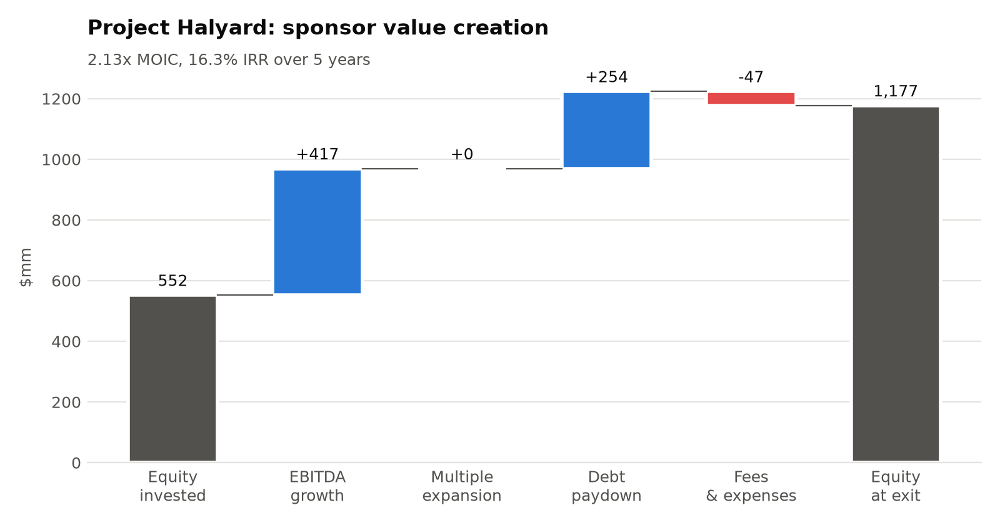
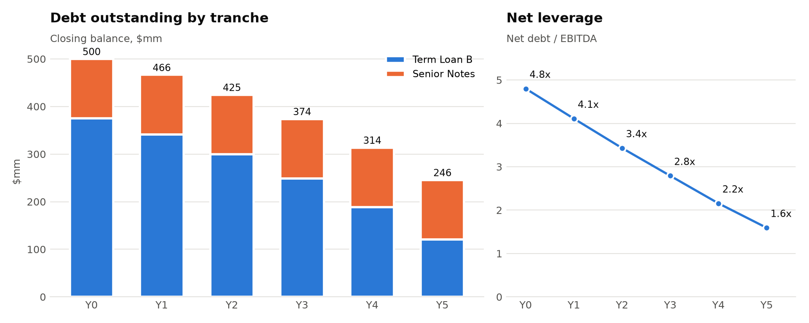
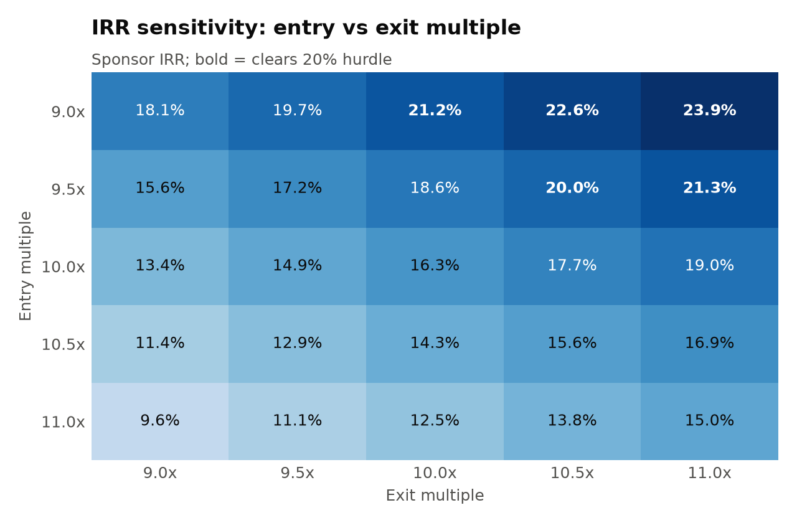

# lbo-engine


A leveraged buyout model written in Python, with a debt schedule that handles multiple tranches, PIK, a revolver and an excess cash flow sweep. It can also export the full model to Excel as live formulas.

I built it because most "LBO in Python" repos stop at a single debt tranche and a hardcoded IRR. I wanted something that behaves like a real sponsor model, and an Excel version a banker could audit cell by cell. The test suite checks that the Excel formulas and the Python engine produce the same IRR to nine decimal places.



## What it does

- **Sources & uses**: debt sized in turns of LTM EBITDA, transaction and financing fees, and sponsor equity as the plug.
- **Operating build**: revenue growth and EBITDA margin by year, with D&A, capex and working capital as a % of revenue.
- **Debt schedule**:
  - any number of tranches, each with its own cash coupon, PIK, mandatory amortization and sweep priority
  - a revolver that funds shortfalls and is repaid first
- **Returns**: exit at any year, MOIC and IRR, and a value creation bridge that splits the equity gain into EBITDA growth, multiple expansion, debt paydown and fees. The bridge is an exact identity, not an approximation.
- **Credit stats**: total and net leverage, interest coverage, cumulative paydown.
- **Sensitivities**: two-way IRR tables over entry multiple, exit multiple, leverage, margin shift or exit year.
- **Excel export**: four formula-driven sheets plus a sensitivity sheet. Formatting follows banking convention (blue inputs, black formulas, green cross-sheet links).

## Quick start

```bash
git clone https://github.com/bmazzoldi/lbo-engine.git
cd lbo-engine
pip install -e ".[dev]"

lbo run cases/project_halyard.toml --excel halyard.xlsx --charts out/
```

```
Returns
  Entry: 10.0x LTM EBITDA, 5.0x leverage, 52% equity
  Exit (Y5): 10.0x, EV 1,417.2, net debt 225.6
  Sponsor equity 552.5 -> 1,177.3
  MOIC 2.13x   IRR 16.3%

Value creation ($mm)
  EBITDA growth             417.2      67%
  Multiple expansion          0.0       0%
  Debt paydown              254.4      41%
  Fees and expenses         (46.7)     -7%
  Total                     624.8
```

The full printout (sources & uses, projections, credit stats) is in [`examples/project_halyard_output.txt`](examples/project_halyard_output.txt), and the generated workbook is [`examples/project_halyard.xlsx`](examples/project_halyard.xlsx).

## The Excel model


Every number on the Model, Sources & Uses and Returns sheets is a formula that traces back to the Assumptions sheet. If you change the entry multiple in Excel, the debt sizing, interest, sweep and IRR all update. The Returns sheet includes a check row confirming that the value creation bridge sums to the equity gain.

## Debt paydown



With a 100% sweep, the term loan absorbs all excess cash while the bullet notes sit untouched. Net leverage falls from 4.8x to 1.6x over five years, which is where most of the non-operating return comes from in a flat-multiple case.

## Sensitivity



At a 10.0x entry, the deal needs to exit at about 11.4x (1.4 turns of expansion) to clear a 20% IRR. Buying a turn cheaper does more for returns than selling a turn higher, because the entry multiple also sets how much equity goes in.

## Defining a deal

Deals are plain TOML files. Here is the base case ([`cases/project_halyard.toml`](cases/project_halyard.toml)), abbreviated:

```toml
name = "Project Halyard"
entry_multiple = 10.0
exit_multiple = 10.0
exit_year = 5
min_cash = 20.0
sweep_pct = 1.0

[operating]
ltm_revenue = 500.0
ltm_ebitda_margin = 0.20
revenue_growth = [0.06, 0.06, 0.05, 0.05, 0.04]
ebitda_margin  = [0.205, 0.21, 0.215, 0.22, 0.22]

[[tranche]]
name = "Term Loan B"
multiple = 3.75
cash_rate = 0.085
amortization = 0.01
priority = 1

[[tranche]]
name = "Senior Notes"
multiple = 1.25
cash_rate = 0.0925
sweep = false
```

[`cases/project_halyard_pik.toml`](cases/project_halyard_pik.toml) adds a 1.0x HoldCo PIK note on top of the same business. The PIK lifts IRR from 16.3% to 17.6%, but net debt at exit is 68% higher (225.6 vs 380.0) because the PIK compounds at 12% and is never paid down. Comparing the two cases shows the risk/return trade-off the extra leverage buys.

You can also use it as a library:

```python
from lbo import Deal, run
from lbo.sensitivity import grid

deal = Deal.from_toml("cases/project_halyard.toml")
result = run(deal)
result.irr, result.moic           # (0.1634, 2.131)
result.debt.loc["Term Loan B"]    # full tranche schedule as a DataFrame

grid(deal, ("leverage", [4.0, 5.0, 6.0]), ("exit_multiple", [9.0, 10.0, 11.0]))
```

## Modeling conventions

These conventions are deliberate and documented, so the Python and Excel versions can match exactly:

| Item | Treatment |
|---|---|
| Interest | Charged on opening balances. This avoids the circular reference that average-balance interest creates, at the cost of slightly overstating interest in years with heavy paydown. |
| Cash sweep | Excess cash first repays the revolver. `sweep_pct` of the remainder then prepays sweep-eligible tranches in priority order. |
| Shortfalls | Funded by the revolver. A warning is raised if the draw exceeds the commitment. |
| Taxes | `max(EBT, 0) × rate`. No NOL carryforward. |
| Financing fees | Capitalized and amortized straight-line for tax. |
| Exit | Enterprise value at `exit_multiple × exit-year EBITDA`, less net debt and exit fees. Equity value is floored at zero. |
| Purchase price | Assumes a cash-free, debt-free acquisition; existing debt is refinanced out of the purchase EV. |

## Tests

```bash
pytest -q
```

- A hand-calculated two-year deal whose IRR you can check on a napkin.
- Mechanics: PIK compounding, mandatory amortization capped at the balance, sweep priority, the revolver holding the minimum cash balance.
- Identities that must hold for every case: sources equal uses, the value bridge sums to the equity gain, and no balance goes negative under a 1,000bp margin miss.
- **Excel tie-out**: each case is exported and its formulas are evaluated with [pycel](https://github.com/dgorissen/pycel). The IRR, MOIC and exit equity must match the Python engine. Scenarios cover the base case, a 50% sweep, a stress case that forces revolver draws, and an early exit.

## Layout

```
src/lbo/
  assumptions.py   deal inputs and TOML loading
  model.py         projection loop, debt schedule, returns, attribution
  sensitivity.py   two-way tables, leverage and margin overrides
  excel.py         formula-driven workbook export
  charts.py        README / report charts
  cli.py           `lbo run` command
cases/             example deals (hypothetical)
tests/
```

## Limitations and next steps

- The model is annual only; there are no quarterly periods or stub periods.
- There are no management rollover, option pool or dividend recap cash flows, so IRR uses a single entry and single exit.
- Rates are fixed. A floating rate on SOFR with a forward curve would be the next addition.
- The sensitivity sheet in Excel holds pasted values. Live Excel data tables don't survive openpyxl.

*All companies and figures in `cases/` are hypothetical.*
